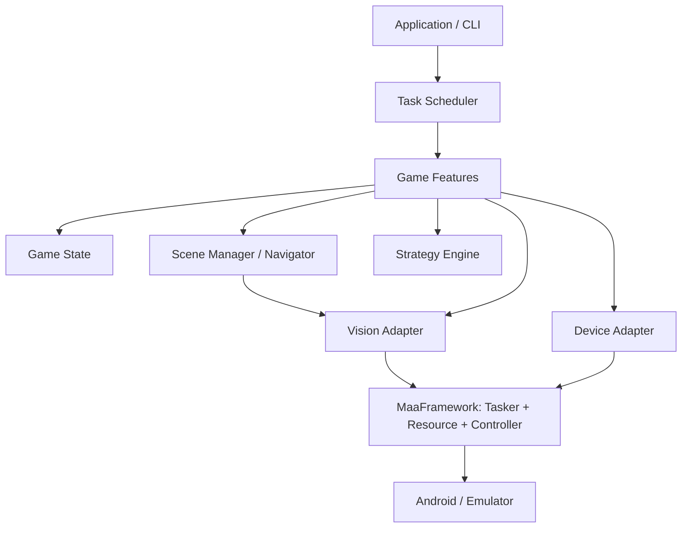

# 架构总览

状态：设计基线，2026-11-26。本文件描述目标架构，不代表相应代码已经实现。

## 1. 项目目标

HBR-Auto 是面向《Heaven Burns Red / 绯染天空》的模块化 Python 自动化应用。项目目标是将设备控制、视觉识别、游戏状态、任务编排和玩法策略拆分为稳定边界，使日常、战斗、迷宫和活动功能可以独立开发、测试和扩展。

首期以 Android 客户端或模拟器通过 ADB 连接为基线。设备层采用接口适配器，后续可扩展其他 MaaFramework Controller，而不让游戏业务感知设备实现。

## 2. 不可变设计约束

1. **纯 Python 控制流程**：不使用 MaaFramework JSON Pipeline，不使用 post_task() 执行业务流程。
2. **MAA 提供底层能力**：MaaFramework 提供 Controller、截图、Resource 生命周期及 Native Vision；Python 负责全部任务流程和游戏业务。
3. **不重复实现视觉引擎**：模板匹配、OCR、颜色、特征和神经网络识别优先使用 Maa Native Vision。只有验证存在能力缺口时才引入补充算法。
4. **业务不依赖 MAA 类型**：游戏模块只能依赖项目内部 Device / Vision 接口和标准结果对象。
5. **识别后再操作**：所有会改变游戏状态的动作都必须有执行前条件和执行后验证。
6. **单设备串行输入**：同一设备上的截图、点击、滑动和识别请求由单一执行队列协调，避免并发操作造成画面与输入错位。
7. **计划与现实分离**：排轴是期望计划，游戏当前画面识别结果才代表运行时状态。两者不一致时默认暂停。
8. **安全边界**：仅使用正常游戏画面识别和设备输入；不实现进程注入、内存修改或网络协议绕过。

## 3. 系统分层

### Application

应用组合根和生命周期入口。读取配置、创建 Runtime、注册任务、构造 TaskContext、启动/停止任务并释放资源。业务模块不得自行创建全局 Maa Runtime。

### Core

- runtime：Maa Resource、Tasker、Controller 的创建、绑定、生命周期和版本检查。
- device：统一截图、点击、滑动和按键接口；MaaDevice 是第一种实现。
- vision：直接调用 MAA 独立识别 API，将 MAA 结果转换为项目内部模型。
- scene：场景检测、场景状态、页面导航和页面转换。
- task：任务接口、上下文、注册、依赖解析、串行调度、取消和执行记录。
- state：当前场景、战斗状态、探索状态等内存模型，以及需要恢复的数据持久化。
- recovery：弹窗、加载、断连、未知画面和任务失败恢复。
- storage：SQLite Repository，不让业务任务直接拼接 SQL。

### Games / Features

- common：登录、回到主界面、通用弹窗和导航。
- daily：每日任务、签到和奖励。
- battle：排轴导入、队伍校验、战斗状态分析和排轴执行。
- dungeon：地图识别、地图状态和路线规划。
- event：活动玩法。

每个功能以 Python 类和函数组织，不以 Pipeline 节点组织。

### Strategies

策略只负责根据 GameState / BattleState 生成决策或计划，不直接点击设备。执行动作交给对应 Executor；Executor 负责确认 UI 条件、执行输入及验证结果。

## 4. 依赖方向

允许：

- Application 依赖 Core 和 Games。
- Games 依赖 Core 的项目内接口和领域模型。
- Strategy 依赖领域模型。
- Adapter 依赖 MaaFramework Python Binding。

禁止：

- Core 依赖具体 Games。
- Games 直接 import maa.*。
- Strategy 直接调用 Controller。
- Task 模块直接访问另一个 Task 的私有状态。
- 业务流程依赖 Pipeline JSON。

## 5. 目标目录

    HBR-Auto/
    ├── app/
    │   ├── application.py
    │   ├── bootstrap.py
    │   └── cli.py
    ├── core/
    │   ├── runtime/
    │   ├── device/
    │   ├── vision/
    │   ├── scene/
    │   ├── task/
    │   ├── state/
    │   ├── recovery/
    │   └── storage/
    ├── games/
    │   ├── common/
    │   ├── daily/
    │   ├── battle/
    │   │   ├── plan/
    │   │   ├── analyzer/
    │   │   └── runtime/
    │   ├── dungeon/
    │   └── event/
    ├── strategies/
    │   ├── battle/
    │   └── dungeon/
    ├── assets/
    │   ├── image/
    │   └── model/
    ├── config/
    ├── tests/
    ├── docs/
    ├── data/
    ├── logs/
    ├── .python-version
    ├── pyproject.toml
    └── uv.lock

以上是目标布局；按照开发阶段逐步创建，不需要一次性建立所有空目录。

## 6. MAA 集成方式

应用初始化时创建并绑定 Resource、Controller 和 Tasker。Resource 只加载视觉所需的图片及模型资源，不加载 Pipeline Bundle。识别通过 Tasker.post_recognition() 独立发起；输入通过 Controller 的截图、点击、滑动等接口执行。

即使不使用 Pipeline，独立识别仍然需要已绑定 Resource 和 Controller 的 Tasker。Tasker 在这里是 MAA 视觉识别的执行入口，不是业务工作流引擎。

业务模块通过项目内接口调用，例如：

    result = context.vision.find_template(
        frame,
        name="daily/claim_button",
        threshold=0.86,
    )
    if result.found:
        context.device.click(*result.center)
        context.scene.wait_until("DAILY_REWARD_UPDATED")

以上仅说明依赖边界；具体参数和结果字段以锁定版本的 MaaVision Adapter 实现为准。

## 7. 并发与生命周期

首版使用一个设备、一个 Runtime、一个串行输入队列。MAA Job 的异步接口不代表允许并发操作同一游戏设备。截图与输入必须有明确顺序；后续增加多设备时，每个设备独立拥有 Runtime、TaskContext 和执行队列。

任务支持协作式取消。消耗道具、确认进入关卡、确认领取奖励等不可逆操作，在结果未知时不得盲目重试。

## 8. 数据与可观测性

- SQLite：任务历史、排轴导入记录、检查点和异常记录。
- 文件日志：应用、任务、识别和设备日志分层。
- 失败截图：按任务 ID 和时间戳保存，并控制保留数量。
- 识别记录：记录算法类型、区域、阈值、命中结果和耗时；不无限期保留完整截图。
- 配置：TOML 只保存运行参数和策略参数，不描述流程。

## 9. 关键质量属性

- 可测试：识别、场景、计划验证和策略可使用截图及状态 fixture 离线测试。
- 可恢复：状态不确定时暂停，而不是猜测。
- 可扩展：新增功能优先新增 Feature，不修改 MaaRuntime。
- 可替换：Maa 类型只存在于 Adapter。
- 可追踪：每个输入动作均可追溯到任务、回合、动作槽位和识别证据。
